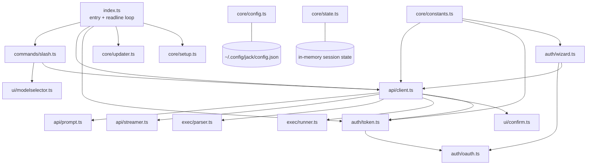
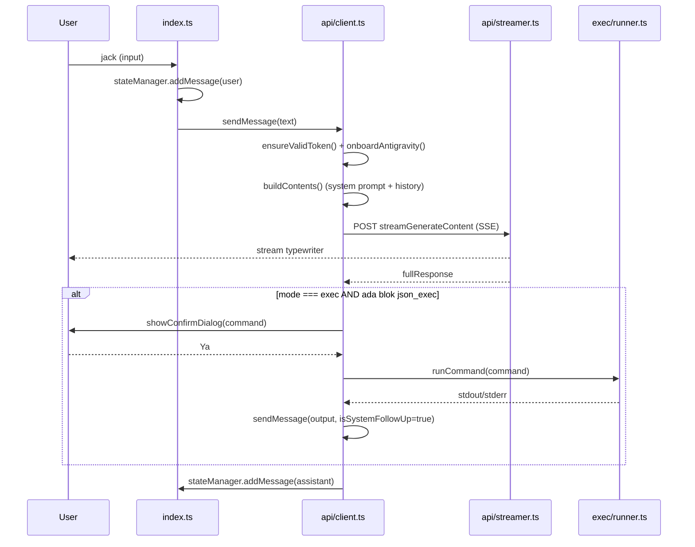
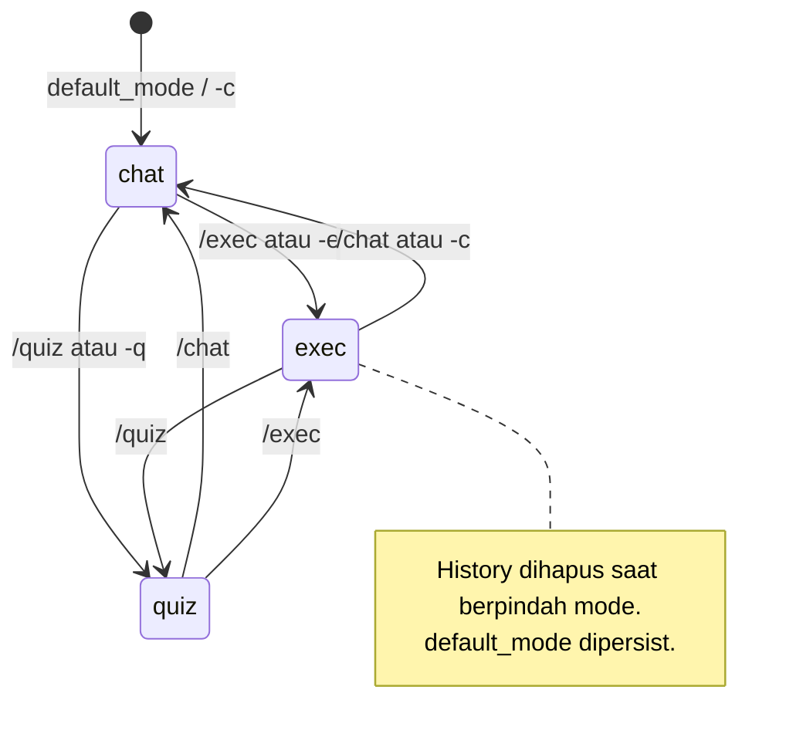

# JACK-AGENT — Product Requirements Document (PRD)

> **Status:** Living document · **Version:** 1.1.9 · **Last updated:** 2026-10-18
> **Owner:** prastya-dev ([@prastya-dev](https://github.com/prastya-dev))

---

## 0. MANDATORY AGENT PROTOCOL — BACA SEBELUM MENGERJAKAN APA PUN

> [!IMPORTANT]
> **Setiap agent (manusia atau AI) WAJIB membaca file ini (`PRD.md`) DAN `TASKS.md` secara utuh SEBELUM melakukan perubahan kode apa pun.**

### Alur wajib

1. **Baca `PRD.md`** — pahami arsitektur, invariant (Bagian 9), dan constraint (Bagian 8). Setiap perubahan yang melanggar invariant akan ditolak pada review.
2. **Baca `TASKS.md`** — periksa apakah pekerjaan sudah ada di backlog/riwayat. Jangan duplikasi task.
3. **Implementasi** — ikuti aturan § 2.4 (Feature Budget) dan § 9 (Invariants).
4. **Setelah selesai — WAJIB update dokumen:**
   - Tambahkan entri baru ke `TASKS.md` bagian **Riwayat Selesai** (format: `## [vX.Y.Z] — YYYY-MM-DD — <judul>`) dengan: ringkasan, file yang diubah, dan verifikasi yang dijalankan.
   - Jika perilaku/fitur/kontrak berubah → update bagian relevan di `PRD.md`, naikkan `Last updated`, dan catat di **Bagian 12 Changelog PRD**.
   - Jika hanya perbaikan bug tanpa perubahan perilaku → cukup update `TASKS.md`.
5. **Naikkan versi** di `package.json` untuk setiap rilis, dan sinkronkan tag GitHub `vX.Y.Z` (trigger workflow release).

### Kalau aturan ini dilanggar

- PR/commit tanpa update `TASKS.md` = **tidak lengkap**, tidak akan di-merge.
- Perubahan perilaku tanpa update `PRD.md` = **tidak lengkap**, tidak akan di-merge.

---

## 1. Ringkasan Produk

**JACK-AGENT** adalah asisten AI berbasis terminal (TUI/CLI) untuk developer dan power user. Aplikasi ini membungkus API **Google Antigravity / Gemini Code Assist** (`cloudcode-pa.googleapis.com`) sehingga pengguna mendapat akses ke model Gemini generasi terbaru langsung dari terminal — termasuk kemampuan **menjalankan perintah shell secara otonom** dengan konfirmasi keamanan.

**One-liner:** `jack` → login Google sekali → chat / eksekusi perintah dengan AI di terminal.

### Masalah yang diselesaikan

| Masalah | Solusi JACK |
| :--- | :--- |
| Akses model AI terbaru butuh setup rumit (API key, SDK, CLI vendor) | Satu binary/NPM, OAuth2 browser sekali klik |
| Perlu pindah-pindah jendela untuk menjalankan perintah yang disarankan AI | **Exec Mode**: AI menyarankan perintah → konfirmasi → dijalankan → output di-feed balik ke AI |
| Pengguna non-Node tidak bisa pakai tool Node | Distribusi binary standalone (pkg) untuk Linux/macOS/Windows |
| Konteks direktori kerja sering salah | System prompt menyuntikkan OS, shell, dan CWD secara dinamis |

### Target pengguna

- Developer backend/frontend yang banyak bekerja di terminal.
- Sysadmin / DevOps yang ingin asisten perintah shell.
- Power user yang sudah punya akun Google dengan akses Gemini Code Assist.

---

## 2. Tujuan, Non-Tujuan, dan Aturan Rekayasa

### 2.1 Tujuan (Goals)

- **G1** — Login Google sekali, token auto-refresh tanpa intervensi.
- **G2** — Tiga mode operasi yang jelas: `chat`, `exec`, `quiz`.
- **G3** — Streaming respons dengan efek typewriter + spinner status.
- **G4** — Fallback model otomatis ketika model utama gagal (429/503/400).
- **G5** — Nol dependensi runtime selain `open` (Node >=18).
- **G6** — Distribusi tiga jalur: NPM, binary standalone, script installer.

### 2.2 Non-Tujuan (Non-Goals) — JANGAN dikerjakan tanpa persetujuan eksplisit

- ❌ GUI/web app. Produk ini **terminal-first**.
- ❌ Multi-user / server mode / daemon.
- ❌ Dukungan multi-provider (OpenAI/Anthropic langsung). Provider tunggal: Antigravity.
- ❌ Penyimpanan riwayat chat persisten lintas sesi (history hanya in-memory, hilang saat exit).
- ❌ Plugin/sistem ekstensi.
- ❌ Autocomplete shell, syntax highlighting, atau editor mode.

### 2.3 Constraint (lihat juga Bagian 8)

- Node.js `>= 18.0.0`.
- Runtime dependency hanya `open@8.4.2`. Menambah dependency baru **harus** dijustifikasi di PRD.
- Harus tetap bisa di-bundle dengan `@yao-pkg/pkg` (tanpa native addon, tanpa file dinamis yang tidak bisa di-resolve saat build).
- Terminal ANSI truecolor; diasumsikan TTY interaktif.

### 2.4 Aturan Rekayasa (WAJIB dipatuhi)

1. **YAGNI ekstrem.** Tanyakan lebih dulu: apakah fitur ini perlu ada? Kalau stdlib Node bisa, pakai stdlib. Kalau `https` sudah cukup, jangan tambah `axios`/`node-fetch`.
2. **Hapus sebelum menambah.** Kode mati dihapus, bukan dikomentari.
3. **Tanpa abstraksi yang tidak diminta.** Dilarang membuat interface yang hanya punya satu implementasi, factory untuk satu produk, atau config untuk nilai yang tidak pernah berubah.
4. **Perubahan minimal.** Diff terpendek yang benar menang.
5. **Bahasa.** Komentar kode boleh Indonesia; **string yang dilihat pengguna WAJIB mendukung dua bahasa** (`id`/`en`) jika fitur tersebut berada di jalur yang sudah ter-i18n (`updater.ts`, `wizard.ts`, `runUninstall`). Untuk modul lama yang masih hardcoded Indonesia, ikuti pola yang ada, jangan refactor massal tanpa task terpisah.

---

## 3. Arsitektur

### 3.1 Peta Modul



| Modul | File | Tanggung jawab |
| :--- | :--- | :--- |
| Entry | `src/index.ts` | Parsing argumen CLI, bootstrap, loop input readline |
| State | `src/core/state.ts` | Singleton in-memory: CWD, mode, model, history, streaming flag |
| Config | `src/core/config.ts` | Baca/tulis `config.json`, deep-merge update |
| Constants | `src/core/constants.ts` | Endpoint, OAuth client, model fallback, default setting |
| Auth | `src/auth/oauth.ts` | PKCE, callback server, exchange code, userinfo, daftar project |
| Auth | `src/auth/token.ts` | Auto-refresh access token (buffer 5 menit) |
| Auth | `src/auth/wizard.ts` | Wizard login, dialog "Connect Antigravity", re-login, uninstall |
| API | `src/api/client.ts` | `sendMessage`, `fetchModels`, onboarding project, fallback model |
| API | `src/api/prompt.ts` | Build system prompt + `contents[]` untuk request |
| API | `src/api/streamer.ts` | Parser SSE + efek typewriter + masking blok `json_exec` |
| Exec | `src/exec/parser.ts` | Ekstraksi perintah dari blok `json_exec` |
| Exec | `src/exec/runner.ts` | `child_process.exec` + daftar pola berbahaya |
| UI | `src/ui/*` | Tema, banner, status bar, dialog konfirmasi, model selector |
| Core | `src/core/updater.ts` | Cek rilis GitHub/NPM, unduh + ganti binary |
| Core | `src/core/setup.ts` | Integrasi OS: context menu Windows, `.desktop` Linux |

### 3.2 Alur Runtime Utama



### 3.3 Jalur Data Konfigurasi

```
~/.config/jack/config.json          (Linux/macOS)
%APPDATA%\jack\config.json          (Windows)

{
  "version": "1.1.9",
  "auth":        { access_token, refresh_token, token_type, expiry_date,
                   user_email, user_name, user_picture },
  "settings":    { default_model, default_mode, confirm_danger_commands,
                   max_history_length, language },
  "environment": { project_id, machine_id, antigravity_project_id? }
}
```

> [!NOTE]
> **Migrasi v1.1.9 (rename `jckw` → `jack`).** Sebelum membaca config, aplikasi memindahkan folder lama (`~/.config/jckw` atau `%APPDATA%\jckw`) ke folder baru (`…/jack`) sekali saja bila folder baru belum ada — sesi login pengguna lama tidak hilang. Bila pemindahan gagal (beda device/izin), pengguna cukup menjalankan `jack --config` untuk login ulang.
> Nama lama juga berubah di seluruh produk: perintah `jack`, paket NPM `@prastya-dev/jack-agent`, repo `prastya-dev/JACK_AGENT`, aset rilis `jack-<platform>-<arch>`, registry Windows `…\shell\JACK`, dan `jack.desktop`/`jack.png` di Linux.

> [!NOTE]
> `client_id` dan `client_secret` **di-embed di binary** (`constants.ts`) dan tidak pernah ditulis ke config. Ini disengaja — jangan ubah tanpa task khusus.

---

## 4. Fitur Fungsional

### F1 — Autentikasi OAuth2 (PKCE)

- **Alur:** generate verifier/challenge → cari port bebas dari 8085 → `http://localhost:<port>/callback` → buka browser → tunggu `code` (race antara callback server dan Ctrl+C) → exchange code → ambil userinfo + daftar project aktif → simpan config.
- **Requirement:**
  - **F1.1** HARUS memakai PKCE `S256`.
  - **F1.2** HARUS mencoba 20 port berurutan dari `OAUTH_REDIRECT_PORT` (8085) bila port terpakai.
  - **F1.3** HARUS memvalidasi `state` pada callback; mismatch → tolak.
  - **F1.4** HARUS menampilkan halaman HTML sukses/gagal ke browser (fungsi `callbackHtml`).
  - **F1.5** HARUS otomatis menyimpan `project_id` dari project ACTIVE pertama; jika tidak ada → tampilkan peringatan.
  - **F1.6** HARUS menyimpan `refresh_token` (`access_type=offline`, `prompt=consent`).

### F2 — Manajemen Token

- **F2.1** HARUS refresh otomatis bila token kedaluwarsa atau kurang dari **5 menit** menuju expiry (`TOKEN_REFRESH_BUFFER_MS`).
- **F2.2** `ensureValidToken()` HARUS dipanggil sebelum setiap request API.
- **F2.3** Kegagalan refresh HARUS menghasilkan pesan yang menyuruh pengguna menjalankan `jack --config`.

### F3 — Tiga Mode Operasi

| Mode | Tema warna | Perilaku prompt sistem | Flag | Slash |
| :--- | :--- | :--- | :--- | :--- |
| `chat` | Cyan | Penjelasan singkat, maks 2–3 kalimat | `-c` | `/chat` |
| `exec` | Merah | Saran aksi sistem + blok `json_exec` | `-e` | `/exec` |
| `quiz` | Hijau | Jawaban super singkat, to the point | `-q` | `/quiz` |

- **F3.1** Mengganti mode HARUS: memperbarui state, mengganti tema, **menghapus history**, membersihkan layar, render ulang banner + status bar, dan mempersist `default_mode`.
- **F3.2** Mode awal mengikuti `settings.default_mode`, ditimpa oleh flag CLI bila diberikan.

### F4 — Exec Mode (Eksekusi Perintah)

- **F4.1** Model HARUS mengeluarkan perintah dalam blok berpagar:
  ````text
  ```json_exec
  { "command": "..." }
  ```
  ````
- **F4.2** Selama streaming di mode exec, isi blok `json_exec` HARUS disembunyikan dan diganti spinner "Generating command..." (`DelayedTypewriter` dengan `hideExec: true`).
- **F4.3** Parser (`extractCommand`) HARUS toleran terhadap JSON terpotong: fallback regex `"command"\s*:\s*"([^"]+)`.
- **F4.4** Pengguna HARUS mengonfirmasi lewat dialog `[?] Jalankan perintah di atas? > [ Ya ] Tidak` (navigasi ←/→ atau `h`/`l`, Enter konfirmasi, Ctrl+C batal).
- **F4.5** Perintah dijalankan dengan `child_process.exec`, `cwd = state.currentDir`, timeout **30 detik**, buffer maks **10 MB**, shell `cmd.exe` (Windows) atau `/bin/sh` (POSIX).
- **F4.6** Setelah eksekusi, output HARUS diinjeksi ke history sebagai pesan user berformat:
  `[OUTPUT PERINTAH TERMINAL]\n<output>\n\nTolong jelaskan hasil output di atas atau berikan perintah selanjutnya jika diperlukan.`
  lalu memicu follow-up otomatis (`sendMessage(output, isSystemFollowUp=true)`).
- **F4.7** Perintah dengan output kosong ditampilkan sebagai `(tidak ada output)`.
- **F4.8** Perintah berbahaya HARUS terdeteksi oleh `isDangerousCommand()`. Daftar pola ada di `exec/runner.ts`.

> [!WARNING]
> **Diketahui belum tersambung:** `confirm_danger_commands` ada di config, dan `isDangerousCommand()` ada di `runner.ts`, tetapi **belum ada pemanggil** yang menegakkan konfirmasi tambahan untuk perintah berbahaya. Lihat `TASKS.md` → T-004.

### F5 — Streaming & Rendering

- **F5.1** HARUS mem-parse SSE dan mendukung beberapa bentuk payload (`response.candidates[0].content.parts[]`, dan varian lain di `extractTextFromChunk`).
- **F5.2** HARUS merender karakter satu per satu dengan delay `TYPEWRITER_DELAY_MS` (default 8 ms).
- **F5.3** HARUS menampilkan spinner braille (`⠋⠙⠹…`) selama menunggu header respons dan selama "thinking..."/"working...".
- **F5.4** HARUS menyimpan cursor (`\x1b[s` / `\x1b[u`) agar spinner tidak merusak output.
- **F5.5** Timeout request: **180 detik**.

### F6 — Fallback Model

- **F6.1** Urutan percobaan: model terpilih → model lain **dengan famili sama** (prefix `gemini`/`claude`/`gpt`/`deepseek`/`qwen`) → model famili lain.
- **F6.2** Pool kandidat = `unique([selectedModel, ...FALLBACK_MODELS])`.
- **F6.3** Error yang memicu fallback: 400, 429, 503, dan error umum lainnya. **Pengecualian:** error yang mengandung `"diverifikasi oleh Gemini Code Assist"` HARUS langsung menghentikan loop agar pengguna melihat link verifikasi.
- **F6.4** Jika memakai model fallback, HARUS menampilkan `(Fallback: Dialihkan menggunakan model <model>)`.
- **F6.5** Jika semua gagal dan status 429 / `RESOURCE_EXHAUSTED` → pesan "Token Anda limit…".

### F7 — Manajemen Model

- **F7.1** `/model` HARUS mengambil daftar dari API (`fetchAvailableModels`); bila gagal → pakai `FALLBACK_MODELS` dengan peringatan.
- **F7.2** Selector HARUS mendukung ↑/↓ dan `j`/`k`, Enter pilih, Esc/`q` batal.
- **F7.3** Model terpilih dipersist ke `settings.default_model`.

### F8 — Slash Commands

| Command | Fungsi | Sumber |
| :--- | :--- | :--- |
| `/chat` `/exec` `/quiz` | Ganti mode | `F3` |
| `/model` | Selector model | `F7` |
| `/clear` | Bersihkan layar + history | — |
| `/token` | Info kuota (statis, penjelasan reset 5 jam) | — |
| `/cd <path>` | Ubah CWD (`path.resolve` relatif terhadap CWD aktif) | — |
| `/help` | Daftar perintah, mode, contoh | — |
| `/exit` `/quit` | Keluar | — |

- **F8.1** Command tak dikenal → peringatan + saran `/help`.
- **F8.2** Saat menjalankan slash command, readline HARUS di-`pause()` lalu di-`resume()` setelahnya.
- **F8.3** `/cd` ke direktori tidak ada → error, state tidak berubah. Kegagalan `process.chdir` diabaikan (konteks binary pkg) selama state sudah diperbarui.

### F9 — CLI Flags

| Flag | Aksi |
| :--- | :--- |
| `--version` / `-v` | Cetak versi, keluar |
| `--uninstall` | Hapus config + binary/paket + registry |
| `--update` | Cek rilis terbaru dan perbarui |
| `--setup` | Pasang integrasi OS (context menu / shortcut) |
| `--config` / `--wizard` | Re-login paksa (hapus token lalu jalankan wizard) |
| `-c` / `-e` / `-q` | Override mode awal |

### F10 — Self-Update

- **F10.1** Sumber versi terbaru, berurutan: GitHub Releases API → NPM Registry → GitHub Tags API.
- **F10.2** Deteksi jalur instalasi: jika `process.pkg` tidak ada → update via `npm install -g @prastya-dev/jack-agent@latest`; jika binary pkg → unduh aset sesuai platform/arch.
- **F10.3** Nama aset: `jack-linux-x64`, `jack-macos-x64`, `jack-win-x64.exe`.
- **F10.4** Platform/arch tak didukung → pesan error yang jelas.
- **F10.5** Penggantian binary: POSIX = rename langsung; Windows = rename lama ke `*.old` lalu pindahkan yang baru.
- **F10.6** Versi sama → pesan "sudah versi terbaru".

### F11 — Integrasi OS

- **Windows:** menulis registry `HKCU\Software\Classes\Directory\Background\shell\JACK` dan `...\Directory\shell\JACK` (label "Run JACK Here", dengan ikon `jack.ico` bila ada). Mencoba `wt.exe` (Windows Terminal), fallback `cmd.exe`.
- **Linux:** menulis `~/.local/share/applications/jack.desktop`, menu konteks KDE (`kio/servicemenus`) dan Nautilus/Nemo (`file-manager/actions`), serta menyalin ikon ke `~/.local/share/icons/hicolor/256x256/apps/jack.png`.
- **macOS:** belum didukung — HARUS menampilkan pesan bahwa OS belum didukung.

### F12 — Uninstall

- Menghapus `config.json`.
- Jika instalasi NPM → `npm uninstall -g @prastya-dev/jack-agent` + bersihkan registry (Windows).
- Jika binary → Windows: tulis `.del.cmd` yang dijalankan terpisah untuk menghapus binary + registry setelah proses keluar; POSIX: `unlink` langsung.
- Kegagalan (butuh sudo/Admin) HARUS memberi instruksi penghapusan manual.

### F13 — Setup Awal (Wizard)

- Urutan HARUS: pilih bahasa → splash → OAuth → tampilkan sukses → ambil daftar model → selector model default → tawaran integrasi OS (default Ya).
- Wizard dijalankan otomatis bila `configExists()` atau `isConfigured()` bernilai false.

---

## 5. Kontrak System Prompt

System prompt disuntikkan ke pesan user **pertama** (bukan sebagai role `system`) karena API target tidak menerima role `system` terpisah.

**Variabel yang disuntikkan:**

| Placeholder | Sumber |
| :--- | :--- |
| `{PLATFORM_OS}` | `os.platform()` + `os.release()` (mode `win32`/`darwin`/`linux` → label manusiawi) |
| `{CURRENT_SHELL}` | `COMSPEC` (Windows) atau `SHELL` |
| `{CURRENT_DIRECTORY}` | `stateManager.get().currentDir` |
| `{CURRENT_MODE}` | `stateManager.get().activeMode` |

**Aturan perilaku yang dikodekan di prompt:**

1. Bahasa jawab: sesingkat mungkin; maksimal 2–3 kalimat; dilarang Markdown bold; fokus CLI.
2. Mode `chat` → penjelasan singkat; jika pengguna meminta aksi sistem, sarankan beralih ke exec.
3. Mode `exec` → **WAJIB** mengecek direktori dulu (`ls -la` / `dir`) sebelum memodifikasi; jawab ≤1 kalimat sebelum blok JSON; **dilarang menyarankan perintah `jack`**.
4. Mode `quiz` → jawaban super singkat, tanpa basa-basi.

**Build `contents[]`:** bila history kosong → satu pesan user berisi `systemPrompt + "\n\n" + userMessage`. Bila ada history → prompt disuntikkan hanya ke pesan user pertama, pesan `assistant` dipetakan ke role `model`, lalu pesan user baru ditambahkan.

---

## 6. State Machine Mode



---

## 7. Keamanan

| Aspek | Kondisi saat ini | Catatan |
| :--- | :--- | :--- |
| Konfirmasi eksekusi | Selalu diminta di mode exec | Baik |
| Deteksi perintah berbahaya | `isDangerousCommand()` ada, **tidak dipanggil** | Celah — lihat T-004 |
| Injection via output terminal | Output mentah dimasukkan ke prompt | Risiko prompt injection tingkat rendah; pantau |
| Penyimpanan token | Plaintext di `config.json` | Diterima untuk tool lokal; jangan naikkan ke keychain tanpa task khusus |
| OAuth client secret | Di-embed di binary | Disengaja; jangan pindah tanpa task khusus |
| Validasi `state` OAuth | Ada | Baik |
| Sanitasi perintah | Tidak ada; bergantung pada dialog konfirmasi | Lihat T-004 |

> [!WARNING]
> **Pola berbahaya yang harus dicek:** `rm -rf /` atau `~`, `mkfs`, `dd if=`, `> /dev/sd*`, `shutdown`, `reboot`, `format c:`, `del /s` `del /q`.

---

## 8. Batasan Teknis & Jebakan yang Diketahui

1. **Auto-refresh token di tengah streaming.** `sendMessage` mengambil `accessToken` **sekali** di awal, sebelum loop fallback. Jika sebuah percobaan memakan waktu dan token kedaluwarsa di tengah loop, percobaan berikutnya memakai token yang sudah mati. Token refresh **tidak** dilakukan di antara iterasi fallback.
2. **History tanpa dedup.** `buildContents` menyuntikkan `systemPrompt` ke pesan user pertama. Setelah `clearHistory()`, injeksi dilakukan ulang — benar. Tetapi jika `role: 'system'` pernah masuk ke history (tidak pernah terjadi saat ini), maka akan di-skip.
3. **`max_history_length` dipotong dari depan.** Setelah potong, pesan user pertama yang lama (yang berisi system prompt) bisa hilang, sehingga injeksi berikutnya bisa tidak terjadi. Perilaku saat ini dapat diterima karena injeksi terjadi per-request pada history yang ada.
4. **Fallback model bersifat "coba semua".** Setiap error selain kasus verifikasi akan mencoba model berikutnya; ini bisa berarti hingga 6 request gagal dalam satu `sendMessage`.
5. **`isSystemFollowUp` hanya mengubah teks spinner**, tidak mengubah payload.
6. **`requestJson` (dipakai onboarding) membaca token sekali** di awal pemanggilan — token kedaluwarsa tidak di-refresh di dalamnya.
7. **`stateManager.state.selectedModel` default** (`'antigravity-gemini-3-pro'`) berbeda dari `DEFAULT_MODEL` di `constants.ts`; nilai state selalu ditimpa saat bootstrap, jadi tidak berbahaya — tetapi jangan mengandalkan default class ini.
8. **Ukuran binary.** `pkg` menggabungkan `dist/**/*.js`; pastikan tidak ada `require` dinamis dengan path yang tidak dapat di-resolve saat build.

---

## 9. Invariants (tidak boleh dilanggar tanpa task eksplisit)

| # | Invariant |
| :--- | :--- |
| **I-1** | Tidak menambah dependency runtime di luar `open`. |
| **I-2** | Semua request API melewati `ensureValidToken()` sebelum dikirim. |
| **I-3** | Setiap perintah yang dieksekusi di mode exec HARUS melalui `showConfirmDialog`. Tidak ada jalur "auto-approve". |
| **I-4** | System prompt selalu disuntikkan pada pesan user pertama dalam `contents[]`. |
| **I-5** | Berpindah mode selalu membersihkan history. |
| **I-6** | Config `client_id`/`client_secret` tidak pernah ditulis ke disk. |
| **I-7** | Output terminal tidak pernah dieksekusi ulang tanpa konfirmasi baru. |
| **I-8** | Kode harus tetap dapat di-bundle dengan `@yao-pkg/pkg` (tanpa native addon, tanpa dynamic require yang tidak resolvable). |

---

## 10. Panduan Kontribusi

### 10.1 Setup

```bash
npm ci
npm run dev          # ts-node src/index.ts
npm run build        # tsc → dist/
npm start            # node dist/index.js
npm run pkg:all      # build 3 binary (butuh ~beberapa menit)
```

### 10.2 Konvensi

- TypeScript strict-ish; hindari `any` baru bila memungkinkan (yang lama boleh dibiarkan sampai ada task khusus).
- Semua pesan error yang dilihat pengguna: sertakan emoji prefix yang konsisten (`✗` untuk error, `⚠` untuk peringatan, `✓` untuk sukses, `➜` untuk info).
- Tema: jangan hardcode kode ANSI di modul UI baru — pakai `getTheme()`.
- Semua output ke `stdout` dengan `process.stdout.write`, kecuali memang log error → `stderr`.

### 10.3 Verifikasi manual waib sebelum menyerahkan pekerjaan

Karena belum ada test otomatis (lihat T-001), verifikasi minimal:

1. `npm run build` tanpa error.
2. Jalankan `npm run dev`, lakukan smoke test pada jalur yang diubah:
   - Perubahan auth → jalankan `jack --config` (login ulang).
   - Perubahan API/streaming → kirim satu pesan di mode chat.
   - Perubahan exec → jalankan perintah trivial, mis. "cek isi direktori ini".
   - Perubahan UI/slash → cek `/help`, `/model`, `/cd`.
   - Perubahan updater → `jack --update` pada versi yang sama (harus mencetak "sudah versi terbaru").
3. Catat bukti (perintah + output yang diamati) di `TASKS.md`.

---

## 11. Roadmap

### 11.1 Prioritas Tinggi

- **R-1** Menegakkan deteksi perintah berbahaya (hubungkan `isDangerousCommand` ke alur konfirmasi). → T-004
- **R-2** Refresh token di dalam loop fallback. → T-005
- **R-3** Tambah test otomatis minimal untuk parser, prompt builder, dan fallback ordering. → T-001

### 11.2 Prioritas Sedang

- **R-4** Dukungan macOS untuk integrasi OS (Quick Action / Service).
- **R-5** `/cd` tanpa argumen kembali ke home — sudah ada; tambahkan `/pwd` untuk menampilkan CWD saat ini.
- **R-6** Konfigurasi `maxOutputTokens` via config alih-alih konstanta.

### 11.3 Backlog / Mungkin Tidak Akan Dikerjakan

- Persist riwayat chat ke disk.
- Dukungan arsitektur `linux-arm64` / `darwin-arm64`.

---

## 12. Changelog PRD

| Versi produk | Tanggal | Perubahan dokumen |
| :--- | :--- | :--- |
| 1.1.9 | 2026-10-18 | Rename produk `jckw` → `jack` (perintah, paket NPM `@prastya-dev/jack-agent`, repo `JACK_AGENT`, aset rilis, registry Windows `…\shell\JACK`, `*.desktop`/`*.png` Linux, banner + logo). § 3.3 diperbarui: jalur config `…/jack` + migrasi otomatis dari `…/jckw`. |
| 1.1.8 | 2026-10-16 | Dokumen dibuat. Mendokumentasikan arsitektur, 13 grup fitur, kontrak prompt, invariant, keamanan, dan roadmap. |
