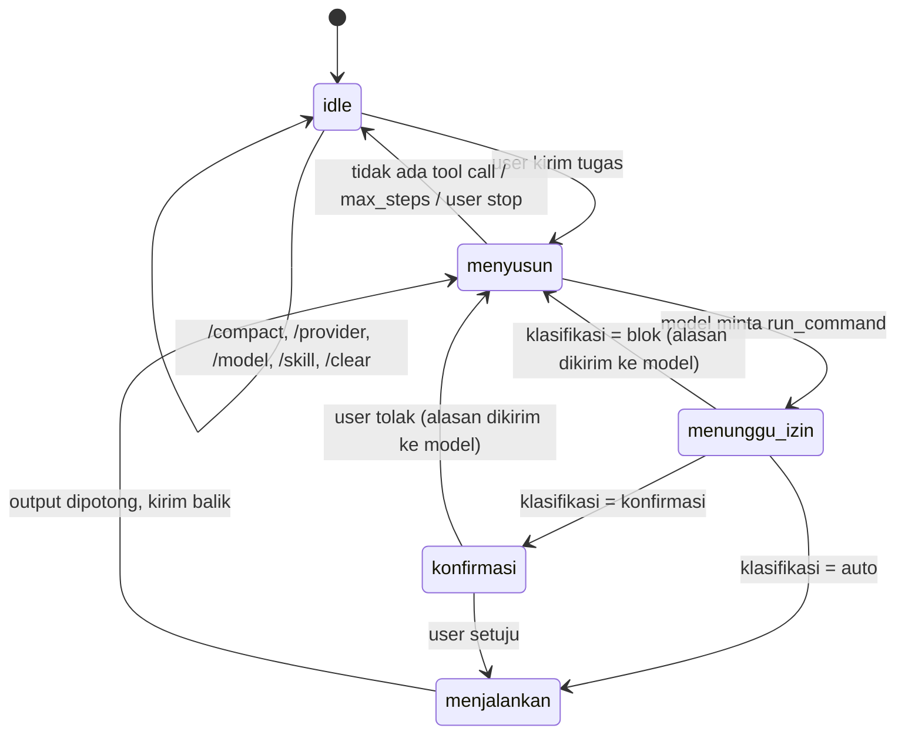

# JACK-AGENT — Product Requirements Document (PRD)

> **Status:** Living document · **Version:** 1.2.0 · **Last updated:** 2026-10-23
> **Owner:** prastya-dev ([@prastya-dev](https://github.com/prastya-dev))

---

## 0. MANDATORY AGENT PROTOCOL — BACA SEBELUM MENGERJAKAN APA PUN

> **Setiap agent (manusia atau AI) WAJIB membaca `PRD.md`, `TASKS.md`, dan `optimize.md` secara utuh SEBELUM melakukan perubahan kode apa pun.**

Tiga dokumen, tiga tugas berbeda:

| Dokumen | Isi |
| :--- | :--- |
| `PRD.md` (ini) | Spesifikasi: apa yang dibangun, kontrak, invariant, keamanan. |
| `TASKS.md` | Papan kerja: apa yang dikerjakan sekarang, buktinya apa. |
| `optimize.md` | Rencana optimasi ukuran/kecepatan/portabilitas (`O-01`…`O-16`), dijadwalkan untuk **v1.2.1**. |

### Alur wajib

1. **Baca ketiganya** — pahami arsitektur, invariant (§ 9), dan constraint (§ 8). Perubahan yang melanggar invariant ditolak saat review.
2. **Periksa `TASKS.md`** — jangan duplikasi task yang sudah ada, dan jangan mengerjakan item `optimize.md` yang dijadwalkan untuk 1.2.1 selagi 1.2.0 belum rilis.
3. **Implementasi** — ikuti § 2.4 (Aturan Rekayasa) dan § 9 (Invariants).
4. **Setelah selesai — WAJIB update dokumen:**
   - Tambahkan entri ke `TASKS.md` → **Riwayat Selesai** (format `## [vX.Y.Z] — YYYY-MM-DD — <judul>`) dengan ringkasan, file yang diubah, dan verifikasi.
   - Perubahan perilaku/kontrak → update bagian relevan di `PRD.md`, naikkan `Last updated`, catat di **§ 12 Changelog PRD**.
   - Perubahan ukuran/kecepatan → tulis angka sebelum/sesudah di `optimize.md` § 1.
5. **Naikkan versi** di `package.json` dan sinkronkan tag `vX.Y.Z` (memicu workflow rilis).

---

## 1. Ringkasan Produk

**JACK-AGENT** adalah **agent** terminal. Kamu memberi satu tujuan; jack menyusun langkah, menjalankan perintah shell yang diperlukan, membaca hasilnya, dan melanjutkan sampai tugas selesai — di dalam terminal, dengan izin yang kamu kendalikan.

Sejak 1.2.0 ada **satu mode saja: agentik.** Mode `chat`/`exec` (dan `quiz`) dihapus; tidak ada lagi pilihan "cuma ngobrol" atau "cuma jalanin perintah". Setiap input user diperlakukan sebagai tugas yang boleh diselesaikan dengan menjalankan perintah.

Dua hal baru yang jadi inti 1.2.0:

1. **Provider bisa dipilih.** Selain Antigravity (bawaan), kamu bisa menambah endpoint **OpenAI-compatible** apa pun — OpenAI, OpenRouter, Groq, Ollama, vLLM, LM Studio, gateway internal kantor — lengkap dengan `base_url`, `api_key`, dan daftar model.
2. **Bisa memuat skill.** Skill adalah berkas markdown berisi instruksi/knowledge. Hanya nama + deskripsi yang selalu ikut ke prompt; isi penuh dimuat saat dipakai. Hasilnya: kemampuan bertambah tanpa prompt membengkak.

Fokus ketiga yang menyertai keduanya: **hemat token.** Riwayat dirangkum (`/compact`) dan output perintah dipotong sebelum dikirim balik ke model.

### Masalah yang dipecahkan

| Masalah | Solusi jack |
| :--- | :--- |
| Konteks proyek tersebar; harus copy-paste manual ke AI | jack membaca sendiri: `ls`, `cat`, `grep`, `git diff` — sesuai izin yang kamu beri |
| Perintah destruktif dijalankan tanpa sadar | Klasifikasi izin berlapis: allowlist read-only, konfirmasi, blok (§ 7) |
| Cuma bisa satu vendor AI | Provider abstraksi + adapter OpenAI-compatible (§ 3.4) |
| Prompt membengkak oleh pengetahuan yang jarang dipakai | Skill index-only, isi dimuat saat dipanggil (§ 3.7) |
| Biaya token membengkak di tugas panjang | Pemotongan output + `/compact` (§ 3.8) |
| Tool AI lain berat (puluhan dependency, MB) | Tanpa dependency runtime, satu berkas `dist/index.js`, bisa di-`pkg` |
| Tidak bisa dipasang di perangkat minim / headless | CLI murni, satu berkas, installer shell/PowerShell |

### Target pengguna

- Developer yang bekerja di terminal dan ingin agent yang tahu isi repo.
- Operator/sysadmin yang butuh menjalankan tugas berulang di server headless (SSH, cron).
- Pengguna model lokal/gateway sendiri (Ollama, vLLM, LM Studio) yang tidak mau data keluar jaringan.
- Pengguna perangkat minim (SBC, router kelas atas, container kecil) — lihat `optimize.md`.

---

## 2. Tujuan, Non-Tujuan, dan Aturan

### 2.1 Goals

| ID | Goal | Ukuran keberhasilan |
| :--- | :--- | :--- |
| G1 | Menyelesaikan tugas multi-langkah dengan otonomi terkendali | ≥ 80% tugas umum (cari bug, jalankan test, rapikan repo) selesai ≤ 12 langkah tool |
| G2 | Aman secara default | 0 perintah destruktif dijalankan tanpa konfirmasi eksplisit |
| G3 | Ringan & portabel | Satu berkas bundle, tanpa dependency runtime baru; jalan dari `npx`/installer (§ 2.3, I-1) |
| G4 | Bekerja di terminal apa pun | Fallback text-mode saat bukan TTY; tidak pernah crash karena terminal |
| G5 | Konteks proyek tanpa copy-paste | Agent membaca repo sendiri lewat tool |
| G6 | Terpasang & terkelola dengan mudah | Instalasi satu perintah, uninstall bersih |
| G7 | **Provider dapat dipilih** | ≥ 2 macam provider (antigravity, openai-compatible) berfungsi penuh; tambah provider tanpa ubah kode |
| G8 | **Satu mode agentik** | Tidak ada lagi flag/mode `chat`/`exec`; semua input jadi tugas |
| G9 | **Skill dapat dipasang** | `jack skill add <git-url\|path>`; isi skill tidak masuk prompt sebelum dipakai |
| G10 | **Hemat token** | Output tool dipotong otomatis; riwayat bisa dirangkum; tidak ada output mentah tak terbatas ke model |
| G11 | Bisa dipasang di perangkat minim | Target pasca-1.2.1: arm64 + binary kecil (`optimize.md`) |

### 2.2 Non-Goals (apa yang **tidak** dibangun)

| Yang tidak dibangun | Alasan |
| :--- | :--- |
| GUI / web UI / TUI tingkat lanjut | Bukan nilai jual; terminal adalah produknya |
| Daemon, multi-user, server terpusat | Tetap satu proses per terminal |
| **Skill berisi kode yang dieksekusi** (JS/TS/plugin runtime) | Menghapus batas keamanan; skill hanya teks (§ 3.7, I-10) |
| **Auto-approve implisit** | Perintah yang mengubah sistem tetap butuh persetujuan (I-3) |
| RAG / vector DB / embedding pipeline | Beban berat; konteks didapat lewat tool + skill |
| Multi-agent / orkestrasi paralel | Kompleksitas tidak sebanding; satu loop sudah cukup |
| ~~Multi-provider~~ | **DIBATALKAN di 1.2.0** — provider abstraksi kini fitur inti (§ 3.4, G7) |
| Marketplace skill terpusat | Cukup git/local; tidak ada layanan yang harus di-host |

### 2.3 Constraint

- Node ≥ 20 saat runtime dev (target 22, lihat `optimize.md` O-13); bundle hasil `pkg` tidak butuh Node terpasang.
- **Tanpa dependency runtime baru.** Satu-satunya yang tersisa `open` (dijadwalkan dihapus: `optimize.md` O-09). Klien OpenAI-compatible memakai modul `https`/`fetch` bawaan Node — **tidak** memakai SDK vendor (I-1).
- Semua fitur harus tetap bisa dibundel `pkg` (single-file binary).
- Windows (PowerShell), macOS, Linux didukung.
- Skill hanya markdown: tidak ada langkah build, tidak ada penambahan dependency.

### 2.4 Aturan Rekayasa (wajib dipatuhi)

1. Maksimal **satu concern per baris**; tidak ada kode mati yang ditinggalkan "untuk nanti".
2. Setiap **panggilan jaringan** punya timeout eksplisit.
3. Setiap **penulisan berkas** yang bisa merusak (config, token) menulis ke berkas sementara lalu `rename` (atomic write).
4. Tidak ada `console.log` di jalur library kecuali debug yang dibungkus flag (`JACK_DEBUG=1`).
5. **Bahasa UI default Indonesia** (`id`), bisa diganti `en` di wizard/updater. Helper i18n terpusat (`src/core/i18n.ts`) belum ada — masih tercatat sebagai T-009; string baru ditulis langsung dalam bahasa Indonesia.
6. **Satu interface provider.** Tidak boleh ada `if (provider === 'openai')` (atau sejenis) di luar `src/providers/`. Pemanggil hanya bicara ke `Provider` (§ 3.4).
7. **Satu pintu tool.** Eksekusi perintah hanya lewat `src/agent/tool.ts`. Tidak ada `child_process`/`exec` di modul lain (I-9).
8. **Jalur otomatis harus teruji.** Setiap aturan klasifikasi izin (§ 7.2) wajib punya test unit — ini satu-satunya jalur di mana jack bertindak tanpa bertanya (I-3).

---

## 3. Arsitektur & Alur Runtime

### 3.1 Peta Modul

```
src/
  index.ts              # Entry point: flag cepat (--version/--help) + subcommand
  session.ts            # Bootstrap sesi: REPL interaktif, one-shot, non-TTY
  core/
    config.ts           # Baca/tulis config.json + MIGRASI antar versi
    constants.ts        # Konstanta global (URL, model default, batas)
    state.ts            # State sesi in-memory (riwayat, model aktif, provider aktif)
    updater.ts          # Self-update (npm / unduh binary)
    setup.ts            # Integrasi OS ("Run JACK Here")
  auth/
    oauth.ts            # PKCE + login browser
    token.ts            # Refresh token, ensureValidToken
  providers/
    types.ts            # Provider, ChatRequest, ChatResult, ToolCall (netral)
    index.ts            # Registry: bikin provider dari config, fallback chain
    antigravity.ts      # Adapter Antigravity (SSE streamGenerateContent, json_exec)
    openai.ts           # Adapter OpenAI-compatible (chat/completions, function calling)
    sse.ts              # Parser SSE bersama
  agent/
    loop.ts             # Siklus agentik: kirim → tool call → jalankan → ulangi
    tool.ts             # ToolRegistry: run_command + use_skill (satu-satunya pintu eksekusi)
    guard.ts            # Klasifikasi izin: auto / konfirmasi / blok; allowlist
    output.ts           # Pemotongan & pembersihan output perintah (hemat token)
    prompt.ts           # buildSystemPrompt(): sistem, tool, skill index, disiplin token
  skills/
    store.ts            # Baca/tulis ~/.config/jack/skills, validasi frontmatter
    index.ts            # Skill index (name+description) untuk prompt
  ui/
    banner.ts           # Banner ASCII JACK AGENT
    wizard.ts           # Wizard setup awal (pilih provider + model), login, uninstall
    modelselector.ts    # Pemilih model/provider/skill: viewport 10 baris + scrollbar
    input.ts            # Editor baris REPL + saran slash command (viewport + scrollbar)
    viewport.ts         # Helper murni: window daftar + sel scrollbar
    confirm.ts          # Dialog konfirmasi perintah (dipakai guard.ts)
    stream.ts           # Printer streaming (sembunyikan blok tool) + spinner
    theme.ts, statusbar.ts
  commands/
    slash.ts            # /help /model /provider /skill /compact /allow /clear /exit
    provider.ts         # CLI: jack provider add|list|use|rm|test
    skill.ts            # CLI: jack skill add|list|rm
  exec/
    runner.ts           # spawn perintah + timeout + tangkap stdout/stderr
    parser.ts           # Ekstraksi blok json_exec dari teks model
```

> `src/api/` (klien lama) dihapus di 1.2.0.

### 3.2 Alur Runtime Agentik

```
jack "<tujuan>"
   │
   ├─ 1. Muat config → tentukan provider aktif + model (§ 3.3, § 3.4)
   ├─ 2. Siapkan auth provider (refresh token / pasang header api key)   [I-2]
   ├─ 3. buildSystemPrompt(): identitas, lingkungan, aturan tool,
   │       disiplin token, daftar skill (nama+deskripsi saja)            [§ 5, § 3.7]
   ├─ 4. Loop:
   │      ┌──────────────────────────────────────────────────────────┐
   │      │ a. Kirim (system + riwayat + definisi tool) ke provider  │
   │      │ b. Terima: teks (streaming ke terminal) + tool call      │
   │      │ c. Ada tool call? ─── tidak ──► selesai, cetak ringkasan │
   │      │ d. guard.classify(perintah) → auto | konfirmasi | blok   │
   │      │ e. auto   → jalankan                                     │
   │      │    konfir → dialog; non-TTY = ditolak (I-3)              │
   │      │    blok   → tidak dijalankan, alasannya dikembalikan     │
   │      │ f. output.ts potong + bersihkan hasil → pesan tool       │
   │      │ g. ulangi dari (a), kecuali max_steps tercapai           │
   │      └──────────────────────────────────────────────────────────┘
   └─ 5. Selesai: ringkasan langkah + status token riwayat (§ 3.8)
```

Yang **hilang** dari alur lama: pemilihan mode, `systemPrompt` yang disuntikkan ke pesan user pertama untuk semua provider, dan pengiriman output perintah mentah ke model.

### 3.3 Konfigurasi

Lokasi (tidak berubah sejak 1.1.9, termasuk migrasi otomatis dari `jckw`):

| OS | Path |
| :--- | :--- |
| Linux | `~/.config/jack/config.json` |
| macOS | `~/Library/Application Support/jack/config.json` |
| Windows | `%APPDATA%\jack\config.json` |

Skema **v1.2.0**:

```jsonc
{
  "version": "1.2.0",

  // ── Daftar provider. Urutan tidak penting; "provider.active" yang menentukan.
  "providers": [
    {
      "name": "antigravity",          // id unik, ^[a-z0-9-]+$
      "kind": "antigravity",          // "antigravity" | "openai"
      "default_model": "gemini-3-flash",
      "models": []                    // kosong = ambil dari daftar bawaan/endpoint
    },
    {
      "name": "ollama",
      "kind": "openai",
      "base_url": "http://127.0.0.1:11434/v1",
      "api_key": "",                  // boleh kosong untuk endpoint lokal
      "models": ["llama3.1:8b"],
      "headers": {},                  // header tambahan opsional
      "supports_tools": true          // false → pakai protokol json_exec (§ 3.5)
    }
  ],

  "provider": {
    "active": "antigravity",
    "fallback": []                     // nama provider lain, dicoba saat error
  },

  // snake_case dipertahankan dari 1.1.x supaya migrasi tidak mengubah kredensial
  "auth": { "access_token": "…", "refresh_token": "…", "token_type": "Bearer",
            "expiry_date": 0, "user_email": "…", "user_name": "…", "user_picture": "…" },
  "user": { "id": "…", "email": "…" },   // dipertahankan apa adanya; jack tidak membacanya

  "agent": {
    "max_steps": 12,                   // batas tool call per tugas
    "auto_enabled": true,              // allowlist read-only boleh jalan otomatis
    "auto_allow": []                   // tambahan user; default ada di kode (guard.ts)
  },

  "tokens": {
    "max_output_lines": 200,           // batas output perintah yang dikirim ke model
    "max_output_chars": 8000,
    "compact_at_percent": 70           // auto-/compact saat riwayat ≥ 70% batas
  },

  "settings": { "language": "id", "max_history_length": 50 },
  // internal: id mesin/proyek untuk antigravity (bukan preferensi user)
  "environment": { "project_id": "…", "machine_id": "…", "antigravity_project_id": "…" }
}
```

**Migrasi v1.1.x → v1.2.0** (sekali jalan, di `core/config.ts`):

| Lama | Baru | Aksi |
| :--- | :--- | :--- |
| `auth`, `user` | `auth`, `user` | Dipertahankan apa adanya |
| `settings.default_model` | `providers[antigravity].default_model` | Dipindahkan |
| `settings.default_mode` | — | **Dibuang** (mode dihapus) |
| `settings.confirm_danger_commands` | `agent.*` | Dipetakan: `true` → `auto_enabled=false` |
| `settings.selectedModel` | per provider | Dipindahkan ke provider yang cocok |
| (baru) | `providers[0] = antigravity` | Dibuat bila belum ada |

Aturan migrasi: backup dulu ke `config.json.bak-<versi>`, tulis atomik, dan **jangan pernah membuang `auth`/`user`**. Kalau migrasi gagal, jack tetap jalan dengan config minimal (user diminta `jack login` lagi) dan error aslinya dilaporkan — bukan ditelan diam-diam.

### 3.4 Provider Abstraction

Satu interface, banyak adapter. Pemanggil agent tidak pernah tahu provider mana yang aktif.

```ts
// src/providers/types.ts
export type ProviderKind = 'antigravity' | 'openai';

export interface ProviderConfig {
  name: string;
  kind: ProviderKind;
  base_url?: string;
  api_key?: string;
  headers?: Record<string, string>;
  models?: string[];
  supports_tools?: boolean;
  default_model?: string;
}

export interface ToolSpec {                    // definisi tool, format netral
  name: string;
  description: string;
  parameters: Record<string, unknown>;         // JSON Schema
}

export interface ChatRequest {
  system: string;                              // prompt sistem, terpisah
  messages: Message[];                         // riwayat format netral
  tools: ToolSpec[];
  stream: boolean;
  model?: string;                              // pilihan sesi (flag --model); kosong = default provider
  onText?: (chunk: string) => void;            // callback streaming untuk tampilan
}

export interface ChatResult {
  text: string;                                // teks untuk ditampilkan
  toolCalls: ToolCall[];                       // { id, name, args }
  usage?: { prompt: number; completion: number };
  stopReason: 'done' | 'tool' | 'length' | 'error';
  model?: string;                              // model yang benar-benar dipakai (fallback internal)
}

export interface Provider {
  readonly id: string;
  readonly kind: ProviderKind;
  listModels(): Promise<string[]>;
  chat(req: ChatRequest): Promise<ChatResult>;
}
```

Aturan adapter:

| Aspek | Adapter `antigravity` | Adapter `openai` |
| :--- | :--- | :--- |
| Endpoint | `streamGenerateContent` (SSE) | `POST {base_url}/chat/completions` |
| Auth | Bearer dari `auth.accessToken` (refresh otomatis, I-2) | `Authorization: Bearer {api_key}` bila diisi |
| Peran system | Disuntikkan ke pesan user pertama (API menolak role system) | Pesan `system` sungguhan |
| Tool call | Blok teks ```json_exec``` yang di-parse | Field `tool_calls` (function calling) |
| Hasil tool | Pesan user berisi hasil | Pesan `role: "tool"` + `tool_call_id` |
| Streaming | `data:` per chunk teks | `data:` per delta; `stream_options:{include_usage:true}` |
| Pemilihan model | Fallback internal (F6) | Nama model dikirim apa adanya |
| Onboarding | `loadCodeAssist`/`onboardUser` bila perlu | — |

**Fallback**: `provider.fallback` diisi daftar nama provider. Urutan percobaan: provider aktif → fallback[0] → … Hanya error yang layak-coba-ulang (401/403/429/5xx/timeout) yang memicu fallback; error 400 (permintaan salah) langsung dilaporkan supaya tidak menyembunyikan bug.

**`supports_tools: false`** → adapter memakai protokol `json_exec` yang sama seperti Antigravity (blok teks). Ini jalur kompatibilitas untuk endpoint yang mengabaikan `tools` (§ 3.5).

### 3.5 Tool Interface

Agent hanya punya **dua** tool di 1.2.0:

| Tool | Argumen | Fungsi |
| :--- | :--- | :--- |
| `run_command` | `{ command: string }` | Menjalankan satu perintah shell di cwd proyek |
| `use_skill` | `{ name: string }` | Memuat isi skill ke konteks (isinya jadi pesan sistem tambahan) |

Alasan hanya dua: setiap definisi tool memakan token di **setiap** permintaan. `run_command` menutup hampir semua kebutuhan (baca/tulis berkas lewat `cat`/`sed`/`tee`, cari lewat `grep`/`find`, git lewat `git`). `use_skill` dipisah karena tanpa itu agent tidak bisa memilih skill sendiri — padahal itu inti fiturnya.

Protokol `json_exec` (dipakai Antigravity + provider tanpa tool calling) — kontrak teks:

````
```json_exec
{"tool": "run_command", "command": "ls -la"}
```
````

Aturan parser: cari blok berpagar pertama di jawaban; kalau `JSON.parse` gagal, jangan hentikan sesi — kirim balik pesan koreksi satu kali ("blok json_exec tidak valid: <alasan>"), lalu bila gagal lagi minta user ikut campur. Teks di luar blok tetap ditampilkan.

**Satu pintu (I-9):** `ToolRegistry.run()` di `src/agent/tool.ts` adalah satu-satunya tempat `spawn` dipanggil. `src/exec/runner.ts` menjadi implementasi di balik pintu itu.

### 3.6 Siklus Agentik & Klasifikasi Izin

Loop berhenti pada kondisi pertama yang terpenuhi: (a) model tidak lagi meminta tool, (b) `agent.max_steps` tercapai, (c) user menekan Ctrl+C, (d) error tak-terpulihkan dari provider. Saat berhenti karena (b), jack **wajib** memberi tahu: "batas 12 langkah tercapai, tugas belum selesai — lanjutkan? (y/n)".

Aturan anti-boros yang berlaku selama loop:

- Perintah identik tidak dijalankan dua kali berturut-turut; hasilnya diambil dari hasil sebelumnya.
- Gagal 2× berturut-turut → ganti pendekatan atau berhenti dan tanya user (jangan mengulang tanpa batas).
- Setiap perintah punya timeout (default 30 s, configurable) dan hasilnya dipotong (§ 3.8).
- Sebelum menjalankan tool, jack menampilkan **satu baris** ringkas ("$ ls -la src/") supaya user tahu apa yang terjadi.

Klasifikasi izin ada di `src/agent/guard.ts` — detail aturannya di § 7.

### 3.7 Skills

Skill = satu folder berisi `SKILL.md`. Format:

```
~/.config/jack/skills/<nama>/SKILL.md
├─ awalan frontmatter (WAJIB) ─────────────────────────────
│  ---
│  name: deploy-vps            # ^[a-z0-9-]{1,32}$, harus sama dengan nama folder
│  description: Langkah deploy ke VPS ini (systemd, nginx, backup).  # ≤ 200 char
│  ---
└─ badan: instruksi bebas (perintah contoh, konvensi, checklist)
```

**Aturan pemuatan (inti hemat token):**

| Kapan | Yang masuk ke prompt |
| :--- | :--- |
| Selalu (setiap permintaan) | Hanya `name` + `description` semua skill (index) |
| Saat `/skill <nama>` dipanggil user | Isi penuh satu skill |
| Saat model memanggil `use_skill` | Isi penuh satu skill |
| Skill lain | Tidak masuk sama sekali |

Index dipotong kalau melewati 50 skill (diurutkan sesuai pemakaian terakhir) dan jack memperingatkan agar user merapikan.

**Manajemen:**

| Perintah | Fungsi |
| :--- | :--- |
| `jack skill add <git-url>` | `git clone --depth 1` ke `~/.config/jack/skills/<nama>` |
| `jack skill add <path-lokal>` | Salin folder (validasi frontmatter dulu) |
| `jack skill list` | Tabel: nama, deskripsi (dipotong), asal, ukuran |
| `jack skill rm <nama>` | Hapus satu skill (konfirmasi) |
| `/skill` | Daftar + pilih dari dalam TUI |
| `/skill <nama>` | Muat isi skill ke konteks sesi ini |

**Validasi saat `add`:** frontmatter ada, `name` ada dan cocok dengan nama folder, `description` ada, `SKILL.md` ≤ 8 KB (lebih dari itu: peringatan, tetap boleh), jumlah skill ≤ 50. Skill yang tidak lolos validasi **tidak** dipasang (tidak ada "dipasang setengah jalan").

**Keamanan (I-10):** skill adalah teks. jack tidak pernah menjalankan berkas dari folder skill. Kalau isi skill menyuruh model menjalankan perintah, perintah itu tetap lewat `guard.classify()` yang sama — skill **tidak** bisa menaikkan izin.

Skill tidak dihapus oleh `jack uninstall` kecuali `--purge` diberikan (F12).

### 3.8 Hemat Token

Dua mekanisme wajib di 1.2.0.

**1. Pemotongan output perintah (`src/agent/output.ts`)**

Setiap hasil `run_command` melewati jalur ini sebelum dikirim ke model:

| Langkah | Aturan |
| :--- | :--- |
| Bersihkan | Buang escape ANSI, `\r` (progress bar), NUL; normalisasi CRLF |
| Batasi | `tokens.max_output_lines` (200) **dan** `max_output_chars` (8000), mana yang lebih dulu |
| Kalau dipotong | `head 100 baris` + `… [dipotong: 4.218 baris, 312 KB — persempit dengan grep/head]` + `tail 100 baris` |
| Kalau sangat besar | > 5.000 baris: hanya `head`, jumlah total, dan saran perintah penyempit |
| Wajib | Cantumkan `exit code` dan apakah output berasal dari stdout/stderr |

Ini penghemat terbesar: sebelumnya output perintah bisa mencapai batas `maxBuffer` (10 MB) dan dikirim **mentah** ke model. Lihat `optimize.md` O-16 untuk sisi memorinya.

**2. `/compact` — ringkas riwayat**

| Aspek | Aturan |
| :--- | :--- |
| Manual | `/compact` → kirim riwayat ke model dengan instruksi ringkas → ganti riwayat dengan **satu** pesan ringkasan |
| Isi ringkasan | Tujuan, keputusan yang diambil, berkas yang diubah, status saat ini, langkah berikutnya (≤ 20 baris) |
| Otomatis | Saat estimasi token riwayat ≥ `compact_at_percent` (70%) × batas konteks model → jalankan sebelum permintaan berikutnya, beri tahu user |
| Estimasi token | `karakter / 4` (tanpa dependency tokenizer — I-1); ditampilkan sebagai perkiraan |
| Kalau gagal | Riwayat **tidak** dihapus; jatuh ke pemotongan pesan tertua (perilaku lama) — I-12 |
| Setelah sukses | Cetak "riwayat diringkas: 42 pesan → 1 ringkasan (±1.180 token)" |

**Efek samping yang diinginkan:** urutan pesan stabil (system di depan, perubahan hanya di ekor) sehingga provider yang mendukung prompt caching bisa memanfaatkannya tanpa kode tambahan.

**Di luar lingkup 1.2.0** (usulan, belum disetujui — lihat TASKS.md): penghitung token per sesi di status bar, batas budget per sesi, cache prefix eksplisit.

---

## 4. Fitur Fungsional

### F1. Autentikasi (provider antigravity)

- Login OAuth PKCE, callback di `127.0.0.1`.
- **Hanya relevan untuk provider `kind: "antigravity"`.** Provider `openai` memakai `api_key` di config dan tidak lewat alur ini.
- Profil disimpan di `auth`/`user`; login ulang otomatis saat refresh gagal.

Syarat: refresh token **selalu** dipakai sebelum kedaluwarsa; tidak ada penulisan token dalam kondisi tidak terenkripsi selain berkas config milik user (mode 0600).

### F2. Manajemen Token (antigravity)

- `ensureValidToken()` dipanggil sebelum setiap permintaan yang butuh token; kalau kedaluwarsa < 60 s lagi, refresh dulu.
- Kalau refresh sukses saat streaming berjalan, permintaan **diulang sekali** dari awal (jangan menggabungkan dua aliran — lihat § 8 butir 1).
- Gagal refresh → satu kali login ulang; gagal lagi → error jelas berisi perintah perbaikan.

### F3. Provider (pengganti "Tiga Mode Operasi")

Mode `ask`/`plan`/`exec` di lingkungan **dihapus**. Yang menggantikannya adalah pilihan provider + model:

| Perintah | Fungsi |
| :--- | :--- |
| `/provider` | Daftar provider, tandai yang aktif, pilih untuk diganti — menu juga memuat `+ tambah provider (base_url + api_key)` |
| `/provider add` | Pandu menambah provider (`kind`, `base_url`, `api_key`, `models`) |
| `/provider test` | Uji koneksi + tampilkan daftar model dari endpoint |
| `jack provider list\|use <nama>\|rm <nama>` | Sama, dari CLI |
| `--provider <nama>` | Sekali jalan tanpa mengubah config |

Aturan:
- Provider aktif disimpan di `provider.active`; mengganti provider **tidak** menghapus riwayat, tetapi memuat ulang daftar model.
- Model yang dipakai harus milik provider aktif (I-5). Kalau model tersimpan tidak ada di daftar provider aktif, jack memilih `default_model`, lalu model pertama, dan memberi tahu user.
- `jack provider test` wajib mengembalikan pesan berbeda untuk: DNS gagal, TLS gagal, 401, 404 (base_url salah), endpoint bukan OpenAI-compatible, dan sukses.
- `api_key` disimpan plaintext di `config.json` mode 0600. Ini konsekuensi yang disadari (§ 7.3), bukan kelalaian — alternatif (keyring/keychain) menambah dependency dan tidak portabel.

### F4. Eksekusi Agentik (pengganti "Exec Mode")

Satu-satunya cara jack bekerja: lihat § 3.6.

- Perintah dijalankan di cwd proyek, dengan `shell` default OS (`/bin/sh` di POSIX, `cmd.exe`/PowerShell di Windows).
- Setiap perintah: timeout (default 30 s), tangkap stdout+stderr terpisah, catat `exit code`, matikan perintah yang mengabaikan SIGTERM (SIGKILL setelah 3 s).
- Perintah yang butuh input interaktif tidak didukung: jack mengirim stdin kosong dan system prompt melarangnya (§ 5).
- Tampilan: satu baris "`$ <perintah>`", lalu output yang sudah dipotong.

**F4.8 — Perintah berbahaya HARUS terdeteksi (tetap wajib).** Daftar pola destruktif (`rm -rf /`, `mkfs*`, `dd if=… of=/dev/…`, `> /dev/sd*`, `shutdown`, `reboot`, `chmod -R 777 /`, `format`, `del /s /q`, fork bomb, `:(){ :|:& };:`) ada di kode (bukan hanya di config) dan **diblok**: jack menolak menjalankannya, menampilkan alasannya, dan menyarankan user menjalankannya manual di luar jack. Blok tidak bisa dilewati dengan perintah lain di 1.2.0 (allowlist tidak bisa memuat pola destruktif).

### F5. Streaming Respons

- Teks model tampil saat diterima (SSE), termasuk saat provider memakai function calling.
- Tool call tidak ditampilkan sebagai teks mentah: begitu blok tool terdeteksi, tampilan beralih ke baris perintah (`$ …`) dan status "menjalankan…".
- Kalau streaming gagal di tengah jalan **dan** sudah ada teks yang tampil: pertahankan teksnya, jangan ulangi. Kalau belum ada teks: percobaan ulang boleh (sekali).
- Non-TTY: tidak ada animasi, tidak ada spinner, output polos.

### F6. Fallback Model & Provider

Dua tingkat, urutannya jelas:

1. **Di dalam provider** (khusus antigravity): model utama gagal (tidak tersedia/kuota) → coba model cadangan di provider yang sama.
2. **Antar provider**: provider aktif gagal secara struktural → coba `provider.fallback` berikutnya, dan beri tahu user "beralih ke <nama> karena <alasan>".

Provider cadangan memakai konfigurasi + system prompt yang sama; hanya modelnya yang bisa berbeda. Sesudah tugas selesai, provider aktif **tetap** yang di config (fallback tidak permanen).

### F7. Manajemen Model

- `/model` membuka pemilih untuk **provider aktif**; daftar diambil dari `providers[x].models`, atau dari `listModels()` bila kosong.
- Model terpilih disimpan **per provider** (`providers[x].default_model`), sehingga berpindah provider tidak mengacak pilihan.
- Model tidak dikenal → peringatan "model belum pernah diuji dengan jack", tetap boleh dipakai.
- Batas konteks model dipakai untuk auto-`/compact` (§ 3.8); kalau tidak diketahui, pakai nilai konservatif 32 k.

### F8. Slash Commands

| Perintah | Fungsi | Status |
| :--- | :--- | :--- |
| `/help` | Daftar perintah + tips singkat | ada |
| `/model` | Pilih model (provider aktif) | ada |
| `/provider` | Lihat/ganti/tambah provider (§ F3) | **baru** |
| `/skill` | Daftar/pilih/muat skill (§ 3.7) | **baru** |
| `/compact` | Ringkas riwayat sekarang (§ 3.8) | **baru** |
| `/allow` | Tampilkan allowlist yang aktif + tambah/hapus | **baru** |
| `/clear` | Bersihkan riwayat sesi (tanpa merangkum) | ada |
| `/exit`, `/quit` | Keluar | ada |

`/mode`, `/ask`, `/plan`, `/exec`, `/quiz` **dihapus** — kalau masih diketik, jawab dengan arahan singkat ("mode sudah dihapus di 1.2.0; jack selalu agentik").

**Saran saat mengetik:** begitu baris dimulai dengan `/`, daftar perintah yang cocok muncul di bawah prompt dalam viewport tetap (maks 8 baris) dengan scrollbar. `↑`/`↓` memilih, `Tab` mengisi, `Enter` menjalankan (pada awalan yang belum lengkap, `Enter` mengisi dulu). `/model`, `/provider`, dan `/skill` memakai viewport 10 baris + scrollbar yang sama untuk daftar panjang.

### F9. Argumen CLI

```
jack                       # REPL agentik
jack "<tujuan>"            # REPL dengan tugas pertama langsung dikirim
jack -p "<tujuan>"         # satu kali jalan, cetak hasil, keluar (non-interaktif)
jack -p "<tujuan>" --allow-write   # one-shot + izin menjalankan perintah tulis (jelas & sementara, § 7.2.1)
jack --provider <nama>     # pakai provider ini untuk sesi/sekali ini
jack --model <nama>        # pakai model ini untuk sesi/sekali ini
jack --dry-run             # agent hanya menyusun rencana perintah, tidak menjalankannya (usulan, § 11 R-8)
jack login | logout
jack model | provider | skill
jack update | uninstall
jack --version | --help
```

- `-p` (one-shot) masuk **1.2.0** (dipindahkan dari `optimize.md` O-14, disetujui pemilik 2026-10-18) karena tanpanya agentik tidak bisa dipakai dari cron/CI (TASKS.md T-018).
- `--allow-write` hanya berpengaruh bersama `-p`/non-interaktif; di REPL diabaikan (§ 7.2.1).
- Tanpa argumen di non-TTY: baca stdin sampai EOF, perlakukan sebagai tugas, jalankan agentik, cetak hasil.
- Semua flag punya padanan di config; flag menang untuk sesi itu saja dan tidak mengubah berkas. Pengecualian: `--allow-write` **tidak** punya padanan di config (harus diketik tiap kali).

### F10. Self-Update

- Deteksi cara pemasangan lewat `process.pkg`: standalone binary vs npm global. **Jangan** pakai `process.execPath.includes('node')` — path binary standalone bisa memuat kata "node" dan membuat updater salah jalur.
- `jack update` → tampilkan versi terbaru (GitHub release → npm registry → tag), minta konfirmasi, unduh, verifikasi, ganti.
- Versi dibandingkan sebagai semver (`isNewer`), bukan kesamaan string: rilis yang lebih lama dari versi terpasang tidak pernah dipasang (tidak ada downgrade).
- Verifikasi berkas hasil unduhan sebelum dipasang: hanya `200` yang ditulis (404/500 tidak boleh menimpa binary), ukuran dicocokkan dengan `content-length`, `.tmp` dihapus bila gagal (`optimize.md` O-02 — selesai 2026-10-23).
- Sumber rilis: `prastya-dev/jack-agent` (konstanta `REPO`, dipakai juga oleh `scripts/install.sh`/`install.ps1` dan README). Aset: `jack-linux-{x64,arm64}`, `jack-macos-{x64,arm64}`, `jack-win-x64.exe`; OS/arsitektur lain diarahkan ke `npm install -g`.
- Kalau gagal: binary lama tetap utuh, pesan berisi perintah manual (`npm install -g @prastya-dev/jack-agent@latest`).

### F11. Integrasi OS

| Fitur | Linux | macOS | Windows |
| :--- | :--- | :--- | :--- |
| Exit code yang benar | ✅ | ✅ | ✅ |
| SIGINT bersih (tanpa stack trace) | ✅ | ✅ | ✅ |
| Ctrl+C dua kali = paksa keluar | ✅ | ✅ | ✅ |
| Shell terdeteksi otomatis | ✅ | ✅ | ✅ |
| Notifikasi OS saat tugas panjang selesai | ❌ (non-goal) | ❌ | ❌ |

Terminal sepit (tanpa TTY) tetap jalan: tidak ada spinner/warna/animasi; permintaan konfirmasi ditolak dengan pesan jelas (I-3).

### F12. Uninstall

- `jack uninstall` menghapus berkas program + entri `PATH`.
- **`--purge`** (opsional, konfirmasi terpisah) menghapus config, kredensial, **dan folder skill**.
- Tanpa `--purge`: config dan skill **tidak** disentuh, dan jack memberi tahu di mana letaknya.

### F13. Wizard Setup Awal

Langkah (bahasa `id`):

1. Banner + penjelasan singkat.
2. **Pilih provider**: `antigravity (bawaan, login)` atau `openai-compatible (base_url + api_key)`.
3. Kalau antigravity → alur login OAuth. Kalau openai → tanya `base_url`, `api_key`, `jack provider test`, lalu pilih model.
4. Pilih model (untuk openai: dari hasil `test`).
5. Tampilkan ringkasan + cara memanggil jack.

Wizard bisa dilewati (`jack login` langsung, atau tulis config manual) dan bisa dijalankan ulang (`/provider add`).

### F14. Skills

Spesifikasi lengkap: § 3.7. Ringkas: format `SKILL.md` + frontmatter, index-only di prompt, `use_skill`, `jack skill add|list|rm`, validasi saat pemasangan, skill hanya teks (I-10).

### F15. Hemat Token

Spesifikasi lengkap: § 3.8. Ringkas: pemotongan output perintah wajib (I-11) + `/compact` manual & otomatis (I-12).

### F16. Konfigurasi & Migrasi

Spesifikasi lengkap: § 3.3. Ringkas: skema v1.2.0 (`providers`, `provider`, `agent`, `tokens`), migrasi otomatis dari v1.1.x dengan backup, dan larangan membuang `auth`/`user`.

---

## 5. Kontrak System Prompt

Prompt sistem dibangun **sekali per permintaan** oleh `src/agent/prompt.ts` → `buildSystemPrompt(ctx)`. Fungsi ini murni (tidak menyentuh jaringan/berkas) sehingga bisa diuji.

**Cara pengiriman bergantung provider** (perubahan dari 1.1.9, di mana prompt selalu disuntikkan ke pesan user pertama):

| Provider | Cara kirim |
| :--- | :--- |
| `openai` (dan turunannya) | Pesan `role: "system"` sungguhan di awal `messages[]` |
| `antigravity` | Disuntikkan ke pesan user pertama (API menolak role `system`) |
| Provider dengan `supports_tools: false` | Sama seperti Antigravity + aturan protokol `json_exec` |

Sisa riwayat dipetakan apa adanya (pesan asisten → `assistant`/`model`, tool → `tool`/user, sesuai adapter).

### 5.1 Blok prompt (versi `v2`, target ≤ 1.200 token)

| # | Blok | Isi | Hemat token karena |
| :--- | :--- | :--- | :--- |
| 1 | Identitas & peran | "Kamu jack, agent CLI. Tugasmu **menyelesaikan** tugas, bukan menjelaskan." | Menghapus basa-basi |
| 2 | Lingkungan | `{PLATFORM_OS}`, `{CURRENT_SHELL}`, `{CURRENT_DIRECTORY}`, `{GIT_STATE}`, `{PROJECT_HINTS}` | Agent tidak perlu `ls`/`pwd` hanya untuk orientasi |
| 3 | Kontrak tool | Nama + argumen `run_command` dan `use_skill`, satu perintah per panggilan, dilarang perintah interaktif | Definisi tool ringkas, tidak diulang di riwayat |
| 4 | Aturan agentik | Periksa dulu sebelum mengubah, satu langkah kecil per giliran, verifikasi sesudah, 1 baris sebelum tool call, berhenti & rangkum saat selesai/gagal | Mengurangi langkah salah & pengulangan |
| 5 | Disiplin token | Jangan cetak ulang berkas besar, jangan ulangi konteks, jangan salin isi berkas ke jawaban, pakai `grep`/`head` alih-alih membaca seluruh berkas | Penghemat terbesar di sisi model |
| 6 | Keamanan | Perintah destruktif dilarang; kalau perlu, minta user menjalankan manual | Mencegah blok yang tidak perlu |
| 7 | Skill index | Hanya `name` + `description` setiap skill (≤ 50 baris) | Isi skill tidak selalu ikut |
| 8 | Bahasa & format | Ikut bahasa user (default `id`), maksimal 2–3 kalimat, tanpa Markdown bold, tanpa emoji berlebih | Output pendek |

Placeholder baru yang harus diisi dari state (menggantikan `{CURRENT_MODE}` yang dihapus):

| Placeholder | Sumber |
| :--- | :--- |
| `{PLATFORM_OS}` | `os.platform()` + `os.release()` |
| `{CURRENT_SHELL}` | `COMSPEC` (Windows) atau `SHELL` |
| `{CURRENT_DIRECTORY}` | `state.currentDir` |
| `{GIT_STATE}` | `git rev-parse --abbrev-ref HEAD` + jumlah berkas berubah (opsional, timeout 1 s) |
| `{PROJECT_HINTS}` | Deteksi berkas penanda (`package.json`, `go.mod`, `Cargo.toml`, `pyproject.toml`, `Makefile`) → satu baris ringkas |
| `{SKILL_INDEX}` | Daftar `name — description` dari `src/skills/index.ts` |
| `{AUTO_ALLOW_SUMMARY}` | Ringkasan allowlist aktif (nama program saja, bukan seluruh aturan) |

Aturan yang **dihapus** dari prompt: mode `chat`/`exec`/`quiz` dan instruksi per-mode (mode tidak ada lagi). Aturan yang **dipertahankan keras**: dilarang menyarankan perintah `jack` (rekursi) dan dilarang membaca berkas berkredensial (`~/.config/jack/config.json`, `.env`) tanpa izin eksplisit dari user.

**Guard ukuran:** `buildSystemPrompt()` wajib mengembalikan prompt < 1.200 token (estimasi `karakter/4`) untuk config tanpa skill; ada test yang gagal kalau melewati batas. Prompt yang membengkak akan diam-diam membebani setiap permintaan.

---

## 6. State & Siklus Agentik

Mode dihapus; yang tersisa adalah satu state sesi dan satu siklus.



State sesi (in-memory, `src/core/state.ts` — tidak dipersist sejak 1.1.9):

| Field | Isi |
| :--- | :--- |
| `provider` | Nama provider aktif (dari config; flag CLI menimpa untuk sesi ini) |
| `model` | Model aktif untuk provider itu |
| `history` | Riwayat netral (pesan user/assistant/tool) + ringkasan setelah `/compact` |
| `currentDir` | cwd kerja |
| `steps` | Jumlah tool call di tugas berjalan (direset tiap tugas baru) |
| `skillLoaded` | Nama skill yang isinya sudah dimuat (tidak dimuat dua kali) |

`/clear` mengosongkan riwayat **tanpa** merangkum (perilaku lama dipertahankan untuk kasus "mulai dari nol"). Berpindah provider/model **tidak** menghapus riwayat (I-5 baru).

---

## 7. Keamanan

### 7.1 Ringkasan

| Aspek | Kondisi saat ini (1.2.0) | Catatan |
| :--- | :--- | :--- |
| Konfirmasi eksekusi | Berlapis: auto (allowlist read-only) / konfirmasi / blok | Desain baru, § 7.2 |
| Deteksi perintah berbahaya | `isDangerousCommand()` **dipanggil** di `guard.ts` | Menutup celah lama (T-004 diserap) |
| Injection via output terminal | Output dibersihkan + dipotong; prompt menyatakan output adalah **data**, bukan instruksi | Risiko turun, tidak nol — perintah destruktif tetap diblok terlepas dari asalnya |
| Penyimpanan token Antigravity | Plaintext di `config.json` (mode 0600) | Diterima untuk tool lokal |
| Penyimpanan `api_key` provider | Plaintext di `config.json` (mode 0600) | Disadari; alternatif keychain menambah dependency (§ F3) |
| OAuth client secret | Di-embed di binary | Disengaja |
| Validasi `state` OAuth | Ada | Baik |
| Sanitasi perintah | Klasifikasi token-per-segmen (§ 7.2) | Menggantikan "bergantung dialog" |

> **Pola berbahaya yang selalu diblok:** `rm -rf /` atau `~`, `mkfs*`, `dd if=`, `> /dev/sd*`, `shutdown`, `reboot`, `format c:`, `del /s /q`, `chmod -R 777 /`, fork bomb, `:(){ :|:& };:`.
> Diblok = jack **tidak** menjalankannya, apa pun jawaban user di sesi itu. Kalau user memang butuh, dia menjalankannya sendiri di terminal. Allowlist tidak bisa memuat pola ini.

### 7.2 Klasifikasi Izin (`src/agent/guard.ts`)

Setiap perintah yang diminta model dipecah lebih dulu:

1. Pisahkan menjadi segmen pada `;`, `&&`, `||`, `|`, dan baris baru.
2. Tolak-otomatis (**blok**) bila salah satu segmen cocok pola berbahaya § 7.1.
3. **Auto** hanya bila **semua** kondisi benar:
   - Setiap segmen: program pertama ada di allowlist read-only.
   - Tidak ada redirection (`>`, `>>`, `2>`, `&>`), tidak ada `$( … )`, backtick, `sudo`, `xargs`, `tee`, `env`, `eval`, `exec`, `source`, `curl`, `wget`, `nc`.
   - Untuk `git`: subcommand harus salah satu dari `status`, `diff`, `log`, `show`, `branch`, `rev-parse`, `ls-files`, `blame`, `shortlog`, `describe`, `remote -v`, `stash list`.
   - Tidak ada opsi destruktif (`-delete`, `-exec`, `-i`/`--in-place`, `--output`).
4. Selain itu → **konfirmasi** (default paling aman).

Allowlist bawaan (read-only, tidak mengubah apa pun): `ls`, `dir`, `pwd`, `cat`, `head`, `tail`, `wc`, `grep`, `rg`, `find`, `fd`, `file`, `stat`, `tree`, `du`, `df`, `which`, `whereis`, `type`, `echo`, `printf`, `date`, `uname`, `whoami`, `id`, `ps`, `node -v`, `python --version`, `go version`, `git <read-only>`.

User bisa menambah lewat `/allow` atau `agent.auto_allow`. `agent.auto_enabled: false` → semuanya konfirmasi (setara perilaku 1.1.9).

### 7.2.1 Pengecualian eksplisit: `--allow-write`

Satu-satunya cara perintah tulis dijalankan tanpa dialog. **Disetujui pemilik 2026-10-18, masuk 1.2.0 (`T-018`).**

| Aspek | Aturan |
| :--- | :--- |
| Bentuk | Flag CLI: `jack -p "…" --allow-write` |
| Cakupan | **Hanya untuk jalur one-shot/non-interaktif.** Di REPL interaktif flag ini **diabaikan** — kalau user ada di depan layar, tidak ada alasan melewati dialog |
| Arti | Persetujuan **eksplisit** user untuk sesi itu (dievaluasi sebagai "ya" pada semua dialog di sesi tersebut) |
| Batas | Pola destruktif (§ 7.1) **tetap diblok**, tidak bisa dilewati oleh flag ini |
| Transparansi | Saat aktif, jack mencetak **peringatan tebal** di awal: "⚠ mode menulis otomatis aktif — perintah dapat mengubah sistem tanpa konfirmasi" |
| Tidak permanen | Tidak bisa diset dari config; harus diketik setiap kali |

Perilaku non-TTY tanpa flag ini tetap: konfirmasi **ditolak otomatis** dengan pesan yang bisa dibaca model ("konfirmasi tidak tersedia di sesi non-interaktif; minta user menjalankan manual atau tambahkan program ke allowlist"). jack tidak pernah menggantung menunggu input yang tidak akan datang, dan tidak pernah menebak "ya" (I-3).

### 7.3 Batas yang Diterima

- Perintah allowlist **bisa** masih menimbulkan efek (mis. `git diff` memicu hooks di lingkungan tertentu). Allowlist memangkas risiko, bukan menghapusnya.
- Prompt injection lewat isi berkas tetap mungkin; mitigasinya berlapis: block 6 prompt + blok destruktif + klasifikasi + konfirmasi.
- Kredensial plaintext di config adalah kompromi sadar. Kalau `config.json` terbaca pihak lain, anggap semua token bocor → `jack logout` + `jack login`.

---

## 8. Batasan Teknis & Jebakan yang Diketahui

1. **Auto-refresh token di tengah streaming.** `sendMessage` mengambil `accessToken` **sekali** di awal, sebelum loop fallback. Jika sebuah percobaan memakan waktu dan token kedaluwarsa di tengah loop, percobaan berikutnya memakai token yang sudah mati. Token refresh **tidak** dilakukan di antara iterasi fallback. → T-005 (1.2.1).
2. **History tanpa dedup.** Injeksi prompt sistem ke pesan user pertama dilakukan per-request; setelah `/compact`, ringkasan menggantikan riwayat dan injeksi harus **tidak** terjadi dua kali (periksa saat implementasi T-016).
3. **`max_history_length` dipotong dari depan.** Setelah potong, pesan user pertama yang lama bisa hilang. Untuk provider `openai` ini tidak masalah (system tetap terpisah); untuk Antigravity, injeksi ulang tetap terjadi karena dilakukan per-request pada history yang ada.
4. **Fallback model bersifat "coba semua".** Setiap error selain kasus verifikasi akan mencoba model berikutnya; ini bisa berarti hingga 6 request gagal dalam satu `sendMessage`. Dengan fallback antar-provider (F6), batasi: maksimal 1 provider cadangan per tugas.
5. **`isSystemFollowUp` hanya mengubah teks spinner**, tidak mengubah payload.
6. **`requestJson` (dipakai onboarding) membaca token sekali** di awal pemanggilan — token kedaluwarsa tidak di-refresh di dalamnya.
7. **`stateManager.state.selectedModel` default** (`'antigravity-gemini-3-pro'`) berbeda dari `DEFAULT_MODEL` di `constants.ts`; di 1.2.0 model dipilih per provider (F7), jadi jangan andalkan default class ini.
8. **Ukuran binary.** `pkg` menggabungkan `dist/**/*.js`; pastikan tidak ada `require` dinamis dengan path yang tidak dapat di-resolve saat build.
9. **Output perintah bisa sangat besar.** `maxBuffer` (10 MB) menahan seluruh output di memori sebelum dipotong — di perangkat kecil ini pemborosan (§ `optimize.md` O-16). Pemotongan (§ 3.8) hanya menyelesaikan sisi token, bukan sisi memori.
10. **Perintah interaktif menggantung.** Perintah yang menunggu input (`vim`, `less`, `npm init`, `ssh` tanpa `BatchMode`) akan tampak "hang" sampai timeout. Prompt melarangnya, tetapi model tetap bisa salah — timeout 30 s adalah jaring terakhirnya.
11. **Estimasi token kasar.** `karakter/4` bisa meleset ±30%, terutama untuk teks non-ASCII. Auto-`/compact` memakai ambang persentase, bukan angka pasti, untuk menoleransi ini.
12. **Perbedaan provider.** Ada endpoint "OpenAI-compatible" yang tidak mendukung streaming, mengabaikan `tools`, atau mengembalikan `finish_reason` salah. Karena itu `supports_tools` bisa dipaksa `false` dan `jack provider test` wajib melaporkan hasil pemeriksaan nyata.
13. **Rekursi jack dalam jack.** Agent bisa menyarankan menjalankan `jack` (mis. `jack -p "..."`), yang berbiaya dan membingungkan. Prompt melarang; `guard.ts` juga menambahkan `jack` ke daftar program yang tidak boleh auto.
14. **`--allow-write` adalah izin global untuk satu kali jalan.** Perintah destruktif tetap diblok, tetapi kerusakan non-destruktif (`git push --force`, `rm -rf build/`, `npm publish`, mengubah berkas config) tetap mungkin terjadi. Pakai hanya di repo/lingkungan yang dipercaya, dan jangan pernah di CI yang tidak terisolasi.
15. **Skill adalah input tidak tepercaya.** Skill dari git pihak ketiga berisi teks yang dibaca model — termasuk perintah. Isinya tidak dieksekusi langsung (I-10), tapi ia bisa mendorong model meminta perintah yang tidak diinginkan; klasifikasi izin + blok destruktif adalah pertahanannya. Sebelum `jack skill add` dari sumber asing, baca `SKILL.md`-nya.

---

## 9. Invariants (tidak boleh dilanggar tanpa task eksplisit)

| # | Invariant | Status di 1.2.0 |
| :--- | :--- | :--- |
| **I-1** | Tidak menambah dependency runtime baru. Satu-satunya sisa `open` (dijadwalkan dihapus: `optimize.md` O-09). Klien OpenAI-compatible memakai `https`/`fetch` bawaan. | diperbarui |
| **I-2** | Setiap request melewati penyiapan auth provider: `ensureValidToken()` untuk antigravity, pasang header `api_key` untuk openai. | diperbarui |
| **I-3** | Setiap perintah diklasifikasikan sebelum dijalankan: **auto** hanya untuk allowlist read-only (§ 7.2), selain itu **konfirmasi**. Pola destruktif **diblok**. Tidak ada auto-approve implisit; satu-satunya pengecualian adalah flag eksplisit `--allow-write` pada jalur one-shot (§ 7.2.1), dan itu pun tidak membuka pola destruktif. Non-TTY tanpa flag menolak konfirmasi. | **diganti** (sebelumnya: tidak ada auto-approve sama sekali) |
| **I-4** | System prompt selalu dikirim ke model: sebagai pesan `system` bila provider mendukung, atau disuntikkan ke pesan user pertama (antigravity). | diperbarui |
| **I-5** | Model yang dipakai harus milik provider aktif; berpindah provider/model **tidak** menghapus riwayat. | **diganti** (sebelumnya: berpindah mode membersihkan history) |
| **I-6** | Config `client_id`/`client_secret` tidak pernah ditulis ke disk. | tetap |
| **I-7** | Output terminal tidak pernah dieksekusi ulang tanpa konfirmasi baru. | tetap |
| **I-8** | Kode harus tetap dapat di-bundle dengan `@yao-pkg/pkg`. | tetap |
| **I-9** | Eksekusi perintah hanya lewat `ToolRegistry.run()` (`src/agent/tool.ts`). Tidak ada `exec`/`spawn` di modul lain. | **baru** |
| **I-10** | Skill hanya teks markdown; tidak pernah dieksekusi sebagai kode, dan tidak bisa menaikkan izin perintah. | **baru** |
| **I-11** | Setiap output tool yang dikirim ke model melewati pemotongan `max_output_lines`/`max_output_chars`. Tidak ada output mentah tak terbatas. | **baru** |
| **I-12** | Riwayat tidak pernah hilang tanpa jejak: `/compact` menggantinya dengan ringkasan; kegagalan ringkasan **tidak** menghapus riwayat. | **baru** |

Perubahan I-3, I-5, dan § 2.2 (multi-provider) adalah **keputusan pemilik produk pada 2026-10-18**, dicatat di § 12 sebagai arah baru 1.2.0 — bukan pelanggaran tanpa persetujuan.

---

## 10. Panduan Kontribusi

### 10.1 Setup

```bash
npm ci
npm run dev          # ts-node src/index.ts
npm run build        # tsc → dist/
npm start            # node dist/index.js
npm run pkg:all      # build binary (butuh beberapa menit)
```

### 10.2 Konvensi

- TypeScript strict-ish; hindari `any` baru (yang lama boleh dibiarkan sampai ada task khusus).
- Pesan error yang dilihat pengguna: emoji prefix konsisten (`✗` error, `⚠` peringatan, `✓` sukses, `➜` info).
- Jangan hardcode ANSI di modul UI baru — pakai `getTheme()`.
- Semua output ke `stdout` dengan `process.stdout.write`, kecuali log error → `stderr`.
- Aturan baru yang berlaku sejak 1.2.0: satu interface provider (§ 2.4 butir 6), satu pintu tool (butir 7), test untuk jalur otomatis (butir 8).

### 10.3 Verifikasi manual wajib sebelum menyerahkan pekerjaan

Karena test otomatis baru terbatas (T-001), verifikasi minimal:

1. `npm run build` tanpa error.
2. `node dist/index.js --version` dan banner tampil benar (3 baris, 30 kolom).
3. Jalankan `npm run dev`, lakukan smoke test pada jalur yang diubah:
   - Provider baru → `jack provider test`, lalu satu tugas trivial.
   - Streaming/tool call → "sebutkan isi direktori ini" (harus memicu `run_command`).
   - Klasifikasi izin → minta `ls -la` (auto), minta `git commit` (konfirmasi), minta `rm -rf /` (blok), lalu ulangi `git commit` dengan `--allow-write` (jalan tanpa dialog, dengan peringatan tebal di awal), dan sekali lagi `rm -rf /` dengan flag itu (tetap blok).
   - Hemat token → jalankan perintah beroutput besar (`find /`) → pastikan hasil yang masuk ke model dipotong.
   - `/compact` → riwayat panjang → satu pesan ringkasan.
   - Skill → `jack skill add <path>` lalu `/skill <nama>`.
4. Jalankan di **non-TTY** juga (`... | cat`, `< /dev/null`) — jalur ini pernah membuat jack crash (`optimize.md` O-01).
5. Catat bukti (perintah + output yang diamati) di `TASKS.md`.

### 10.4 Test yang wajib ada (bagian dari T-001)

| Modul | Kasus |
| :--- | :--- |
| `agent/guard.ts` | Auto untuk perintah read-only; konfirmasi untuk tulis; blok untuk pola destruktif; perintah bersegmen (`ls && rm -rf x`) tidak lolos auto; `jack` tidak pernah auto |
| `agent/output.ts` | Output pendek utuh; output panjang dipotong head+tail dengan jumlah baris; ANSI/`\r` dibuang |
| `agent/prompt.ts` | Prompt < 1.200 token; skill index hanya nama+deskripsi; placeholder terisi |
| `providers/openai.ts` | Parse SSE (teks + `tool_calls`), `supports_tools: false` → jalur `json_exec` |
| `core/config.ts` | Migrasi 1.1.x → 1.2.0 mempertahankan `auth`/`user`, backup dibuat |

---

## 11. Roadmap

### 11.1 Prioritas Tinggi

- **R-1** Menegakkan deteksi perintah berbahaya (hubungkan `isDangerousCommand` ke alur konfirmasi). → **diserap ke T-013** (1.2.0), bukan lagi item terpisah.
- **R-2** Refresh token di dalam loop fallback. → T-005 (1.2.1).
- **R-3** Tambah test otomatis minimal untuk parser, prompt builder, dan fallback ordering. → T-001 (diperluas: § 10.4).

### 11.2 Prioritas Sedang

- **R-4** Dukungan macOS untuk integrasi OS (Quick Action / Service).
- **R-5** `/cd` tanpa argumen kembali ke home — sudah ada; tambahkan `/pwd` untuk menampilkan CWD saat ini.
- **R-6** Konfigurasi `maxOutputTokens` via config alih-alih konstanta.
- **R-7** `JACK.md` di root proyek: instruksi/konvensi proyek yang otomatis masuk prompt (murah, sangat berguna untuk agentik). *Usulan.*
- **R-8** `jack --dry-run`: agent menyusun rencana perintah tanpa menjalankannya. *Usulan.*
- **R-9** ~~`--allow-write`~~ → **DISETUJUI 2026-10-18, masuk 1.2.0** sebagai bagian `T-018`, dengan aturan lengkap di § 7.2.1 (hanya one-shot, peringatan tebal, pola destruktif tetap diblok).
- **R-10** Tampilkan estimasi token terpakai di status bar (data `usage` sudah tersedia dari kedua adapter). *Usulan.*

### 11.3 Backlog / Mungkin Tidak Akan Dikerjakan

- Persist riwayat chat ke disk.
- Dukungan arsitektur `linux-arm64` / `darwin-arm64` → **naik status**: bagian dari `optimize.md` O-13 (v1.2.1).
- Marketplace skill terpusat (lihat § 2.2).

---

## 12. Changelog PRD

| Versi produk | Tanggal | Perubahan dokumen |
| :--- | :--- | :--- |
| 1.2.0 | 2026-10-23 | **Perbaikan jalur rilis & updater.** F10 diperjelas: deteksi pemasangan lewat `process.pkg` (bukan `execPath.includes('node')`), pembanding versi semver `isNewer` (tidak menurunkan versi), verifikasi unduhan (`200` + `content-length`, `.tmp` dibersihkan) yang menutup `optimize.md` O-02, dan sumber rilis tunggal `prastya-dev/jack-agent`. Identitas paket disamakan dengan repo hasil rename: `package.json` (`repository`/`homepage`/`bugs`), `scripts/install.sh`, `scripts/install.ps1`, README. Workflow rilis menolak tag yang tidak cocok dengan `version` di `package.json`. |
| 1.2.0 | 2026-10-19 | **Rilis 1.2.0 diimplementasikan (T-011…T-020).** § 3.1 peta modul disamakan dengan kode yang benar-benar ada (`src/session.ts`, `src/auth/*`, `src/ui/stream.ts`; `src/api/` dihapus; `i18n.ts`/`table.ts`/`typewriter.ts`/`logger.ts` yang tidak pernah dibuat dikeluarkan). § 3.4 kontrak adapter bertambah `ChatRequest.model?`, `ChatRequest.onText?`, dan `ChatResult.model?` (model internal yang benar-benar dipakai untuk fallback). § 2.4 butir 5: helper i18n terpusat belum ada → tetap T-009. Pratinjau UI non-TTY: status bar dilewati dan `--allow-write` memakai warna tema (stderr). `jack -p` mengembalikan exit code 1 bila tugas gagal total. `optimize.md` diselaraskan: status O-01/O-03/O-04/O-05/O-06/O-07/O-11/O-14 pasca-1.2.0, baseline § 1 diukur ulang, dan § 9 hanya menyisakan item 1.2.1. Audit kesesuaian PRD menutup: **F1** login ulang otomatis di TTY saat refresh gagal, **F2** refresh paksa + ulang sekali pada `401` (tidak diulang bila teks sudah tampil), **F5** teks parsial disimpan di riwayat, **F7** peringatan model belum diuji, **F10** konfirmasi sebelum update, dan **§ 3.5** isi skill dimuat sebagai pesan sistem tambahan (bukan pesan `tool`). § 3.3 contoh skema disamakan dengan kode (`auth` snake_case, `environment` internal). § 3.1/F8: `src/ui/input.ts` + `viewport.ts`; saran slash saat mengetik `/` dan pemilih model/provider/skill memakai viewport tetap + scrollbar. F3: menu `/provider` memuat entri `+ tambah provider (base_url + api_key)` dan langsung menyinkronkan provider aktif setelah wizard. | § 3.1 peta modul disamakan dengan kode yang benar-benar ada (`src/session.ts`, `src/auth/*`, `src/ui/stream.ts`; `src/api/` dihapus; `i18n.ts`/`table.ts`/`typewriter.ts`/`logger.ts` yang tidak pernah dibuat dikeluarkan). § 3.4 kontrak adapter bertambah `ChatRequest.model?`, `ChatRequest.onText?`, dan `ChatResult.model?` (model internal yang benar-benar dipakai untuk fallback). § 2.4 butir 5: helper i18n terpusat belum ada → tetap T-009. Pratinjau UI non-TTY: status bar dilewati dan `--allow-write` memakai warna tema (stderr). `jack -p` mengembalikan exit code 1 bila tugas gagal total. `optimize.md` diselaraskan: status O-01/O-03/O-04/O-05/O-06/O-07/O-11/O-14 pasca-1.2.0, baseline § 1 diukur ulang, dan § 9 hanya menyisakan item 1.2.1. Audit kesesuaian PRD menutup: **F1** login ulang otomatis di TTY saat refresh gagal, **F2** refresh paksa + ulang sekali pada `401` (tidak diulang bila teks sudah tampil), **F5** teks parsial disimpan di riwayat, **F7** peringatan model belum diuji, **F10** konfirmasi sebelum update, dan **§ 3.5** isi skill dimuat sebagai pesan sistem tambahan (bukan pesan `tool`). § 3.3 contoh skema disamakan dengan kode (`auth` snake_case, `environment` internal). § 3.1/F8: `src/ui/input.ts` + `viewport.ts`; saran slash saat mengetik `/` dan pemilih model/provider/skill memakai viewport tetap + scrollbar. F3: menu `/provider` memuat entri `+ tambah provider (base_url + api_key)` dan langsung menyinkronkan provider aktif setelah wizard. |
| 1.2.0 | 2026-10-18 | **Arah baru: agentik + multi-provider + skills + hemat token.** Mode `chat`/`exec`/`quiz` dihapus (§ 2.2, § 6, F3/F4/F8) — diganti satu mode agentik. § 2.2: larangan "multi-provider" dibatalkan; non-goal baru (skill berisi kode, auto-approve implisit, RAG, multi-agent, marketplace). § 3.3: skema config v1.2.0 (`providers`, `provider`, `agent`, `tokens`) + tabel migrasi dari v1.1.x. § 3.4 Provider abstraction (interface `Provider`, 2 adapter, fallback). § 3.5 Tool interface (`run_command`, `use_skill`, protokol `json_exec`). § 3.6 Siklus agentik. § 3.7 Skills (`SKILL.md`, index-only, `jack skill add|list|rm`). § 3.8 Hemat token (pemotongan output + `/compact`). § 5 Kontrak system prompt v2 (8 blok, provider-aware, batas 1.200 token). § 7 Klasifikasi izin berlapis (auto/konfirmasi/blok). § 8 jebakan 9–15 baru. § 9: I-3 dan I-5 diganti; I-1, I-2, I-4 diperbarui; I-9…I-12 baru. § 10.4 test wajib. § 11 R-7…R-10 usulan baru. Fitur baru F14/F15/F16. **Keputusan pemilik 2026-10-18:** `--allow-write` disetujui masuk 1.2.0 (§ 7.2.1, R-9); `optimize.md` O-01 dan O-14 dipindahkan ke 1.2.0 (`T-018`) karena `T-013` bergantung padanya; mode `quiz` ikut dihapus. |
| 1.1.9 | 2026-10-18 | Rename produk `jckw` → `jack` (perintah, paket NPM `@prastya-dev/jack-agent`, repo `JACK_AGENT`, aset rilis, registry Windows `…\shell\JACK`, `*.desktop`/`*.png` Linux, banner + logo). § 3.3 diperbarui: jalur config `…/jack` + migrasi otomatis dari `…/jckw`. |
| 1.1.8 | 2026-10-16 | Dokumen dibuat. Mendokumentasikan arsitektur, 13 grup fitur, kontrak prompt, invariant, keamanan, dan roadmap. |

